# 🎄 Christmas for Claude Code

A Christmas theme for the Claude Code terminal.

<p align="center">
  
</p>

- **A garland around the prompt.** A pine garland runs along the top of the prompt, strung with chasing coloured lights and hung with bells, bows and stars. Below it lies a snowbank where trees glow gold, presents sit, frost glints and, every so often, a reindeer sleigh 🦌🦌🛷 glides by. Every session gets its own random layout.
- **Bells that ring carols.** Move the mouse onto a 🔔 on the garland and it rings a carol: Jingle Bells, We Wish You a Merry Christmas, Deck the Halls, Carol of the Bells, Silent Night, Joy to the World, O Christmas Tree or Hark! The Herald Angels Sing. Each bell has its own carol. While it rings, the bell flashes, notes float up from it and the carol's name shows beside it. Hover another bell to switch carols; click the ringing bell to hush it.
- **Snow over the conversation.** Flakes fall through your chat, swaying as they go. The snow stops while you select text, so it never ends up in what you copy.
- **Festive words.** The spinner says things like *Decking the halls…*, *Roasting chestnuts…* or *Checking it twice…*, and finished turns read *Wrapped for 12s*.
- **Santa, if you like.** With sounds on, each keystroke tinkles like a sleigh bell or, now and then, plays a glockenspiel note. Enter answers with Santa's *Ho! ho! ho!* (jolly, deep, a four-ho belly laugh, or arriving with sleigh bells), a shake of sleigh bells, church bells, a chime, or *"and a happy New Year!"*. Every Enter sound plays once before any repeats, and the same one never plays twice in a row. Sounds are off until you turn them on.

## Install

At the prompt of a Claude Code terminal session:

```
/plugin install christmas --marketplace phuclh/claude-christmas
```

Answer `y` to add the marketplace, then pick a scope (user is the first one; press Enter).

Or from a shell:

```sh
claude plugin install christmas --marketplace phuclh/claude-christmas
```

In the desktop app, where `/plugin` does not run: click + next to the prompt box, then Plugins, Add marketplace with `phuclh/claude-christmas`, then Add plugin.

## Use

- `/christmas` turns the theme off and on. Your choice is remembered across sessions.
- `/christmas bells` mutes and unmutes the carols. Muted, a bell you hover still flashes and shows its carol's name.
- `/christmas sounds` turns the typing and Enter sounds on and off, and is remembered too.
- Sounds play on macOS only: Claude Code plays them with `afplay`, and plays nothing on Linux or Windows.
- After 90 seconds with no typing, no work from Claude and no carol ringing, the animation pauses and stops using CPU. It wakes as soon as you type, Claude starts working or you hover a bell.

If you also have the [Halloween theme](https://github.com/phuclh/claude-halloween), run `/halloween` to turn it off first, or the two frames draw over each other.

## Requirements

- **Fullscreen mode** for the garland, the bells and the snow: set `"tui": "fullscreen"` in `~/.claude/settings.json`, or switch with `/tui`. On other screens you get the festive words and a small garland on the hint line.
- **A recent Claude Code.** The theme uses Claude Code's early-access function-hook API, which may change between releases. Built and tested on Claude Code 2.1.316.

## Develop

```sh
claude --plugin-dir ./plugins/christmas       # run it from this folder
claude plugin validate ./plugins/christmas    # check the manifest and hooks
claude plugin test ./plugins/christmas        # run the tests
```

The demo above is drawn by the plugin's own frame, snow and bell code. To render it again after a change:

```sh
npx -p typescript tsc -p scripts
node .demo-build/scripts/render-demo.js > assets/demo.svg
```

Every sound is synthesized by `scripts/render-sounds.mjs`: the carols on a glockenspiel (inharmonic bar modes) over a soft bass and chords, the church bells by FM, the sleigh bells from bursts of high partials, and Santa's laugh from a small formant synthesizer. Nothing is recorded or sampled, and the carols are traditional tunes in the public domain. To render them again into `plugins/christmas/sounds/`:

```sh
node scripts/render-sounds.mjs
```
